# 🔤 Awesome Typography & Typeface Collection

<p align="center">
  
</p>

<p align="center">
  <a href="https://github.com/ishandutta2007/Awesome-Awesome-Awesome"></a>
  <a href="https://discord.gg/jc4xtF58Ve"></a>
  <a href="https://github.com/ishandutta2007/Awesome-Typography-Typeface-Collection/stargazers"></a>
  <a href="https://github.com/ishandutta2007/Awesome-Typography-Typeface-Collection/network/members"></a>
  <a href="https://github.com/ishandutta2007/Awesome-Typography-Typeface-Collection/blob/main/LICENSE"></a>
  <a href="https://github.com/ishandutta2007/Awesome-Typography-Typeface-Collection/pulls"></a>
  <a href="https://github.com/ishandutta2007"></a>
</p>

---

## 📖 Overview & SEO Summary

Welcome to the definitive **Awesome Typography & Typeface Collection** — an expertly curated repository of top-tier **open-source fonts**, **variable typefaces**, **developer monospace coding fonts**, **self-hosted font distribution pipelines**, and **commercial SaaS font platforms**.

Whether you are designing a high-conversion SaaS web application, embedding performant WOFF2 assets into modern frontend frameworks (React, Vue, Next.js, Svelte), optimizing typography rendering for international scripts, or discovering SIL Open Font License (OFL) alternatives to expensive enterprise font licensing, this directory provides vetted tools and type families.

> **Key Focus Areas**: *SIL Open Font License (OFL 1.1) • Variable Font Axes (`wght`, `wdth`, `slnt`, `ital`, `opsz`) • WOFF2 Web Fonts • Self-Hosted NPM Packaging via Fontsource • Programming Ligatures • Global Script Inclusivity • Foundry Ecosystems*

---

## 📑 Table of Contents

- [🌐 Sector Overview & Market Dynamics](#-sector-overview--market-dynamics)
- [🏢 SaaS & Hosted Commercial Platforms](#-saas--hosted-commercial-platforms)
- [🚀 Open-Source GitHub Projects](#-open-source-github-projects)
  - [⭐ Open-Source Projects Sorted by Stars](#-open-source-projects-sorted-by-stars)
  - [🔍 Deep-Dive Project Breakdowns](#-deep-dive-project-breakdowns)
- [📐 Typography Anatomy & Variable Font Standards](#-typography-anatomy--variable-font-standards)
- [🤝 How to Contribute](#-how-to-contribute)
- [⚖️ Disclaimer & Font Licensing](#️-disclaimer--font-licensing)
- [📈 Star History](#-star-history)
- [💖 Support & Community](#-support--community)

---

## 🌐 Sector Overview & Market Dynamics

The global digital typography, font software, and typeface licensing market is estimated at **$1.15 billion in 2024–2025** and projected to expand to **$1.75 billion by 2032** (registering a compound annual growth rate of ~6.8%), propelled by rapid expansion in cross-platform digital product UIs, mobile operating systems, variable font CSS specifications, and enterprise brand harmonization. The commercial typeface industry is **moderately concentrated at the top tier**—dominated by mega-consolidators like **Monotype Imaging** (which acquired Linotype, Hoefler&Co, Bitstream, FontFont, and runs MyFonts) and **Adobe Fonts** (deeply embedded into the Creative Cloud ecosystem)—while being energized by a decentralized long tail of boutique indie type foundries and an increasingly dominant, community-driven open-source font distribution movement led by Google Fonts and Fontsource.

---

## 🏢 SaaS & Hosted Commercial Platforms

The table below compiles leading hosted and enterprise font platforms, sorted in descending order by **Company Size / Valuation**.

| 🏷️ Platform | 💰 Company Size / Valuation | 💳 Starting Tier Pricing | 🎁 Free Tier Limit | 🌟 Key Features & Target Use Cases | 🔗 Official Link |
| :--- | :--- | :--- | :--- | :--- | :--- |
| **Adobe Fonts** | **~$215 Billion Market Cap** *(Adobe Inc. NASDAQ: ADBE; ~$21.4B Annual Revenue)* | **$9.99/month** *(via InCopy single-app CC plan with complete Adobe Fonts library)* | **Free Adobe ID**: 1,000+ fonts for web & desktop forever; **7-day free trial** for full 20,000+ font catalog | Enterprise-grade type library featuring top foundry releases (including The League of Moveable Type). Zero per-pageview fees within Adobe ecosystem; syncs natively with Photoshop, Illustrator, and web projects. | [Adobe Fonts](https://fonts.adobe.com/) |
| **Canva Typography Suite** | **~$26 Billion Valuation** *(Canva Pty Ltd; ~$2.3B Annual Revenue)* | **$14.99/month** or **$119.99/year** *(Canva Pro single user)* | **Free forever plan**: access to 1,000+ standard open/licensed fonts, 5GB cloud storage; **30-day free trial** for Canva Pro (unlocks 3,000+ premium fonts & brand kit upload) | Cloud design platform with embedded font library, real-time typographic pairing recommendations, custom font upload engine, and multi-format export for marketing teams. | [Canva Fonts](https://www.canva.com/fonts/) |
| **Monotype Fonts** | **~$825 Million Valuation** *(Acquired by HGGC; ~$250M+ Annual Revenue)* | **$99/year** *(equivalent to $8.25/month billed annually for Individual Standard plan)* | **14-day free trial**: prototyping & mockup sync access across 150,000+ fonts (desktop mockup/testing only, no live production deployment) | The world's largest commercial typeface catalog (Helvetica Now, Futura Now, Gotham, Gill Sans). Enterprise brand governance, single-dashboard font asset management, and digital agency client licensing. | [Monotype Fonts](https://www.monotype.com/fonts) |
| **Fontspring** | **~$50 Million Valuation** *(Part of Darden Studio / Creative Market)* | **$19.00 one-time** *(perpetual desktop license per single font style)* | **700+ free promotional & demo fonts** forever with full desktop installation; unlimited in-browser font test-drive specimens | "Worry-Free" licensing without subscription lock-in or recurring monthly pageview audit traps. One-time payment perpetual web, desktop, and ebook licenses with zero domain restrictions. | [Fontspring](https://www.fontspring.com/) |
| **Type Network** | **~$15 Million Valuation** *(Type Network LLC)* | **$12.00/month** *(web font subscription up to 10k monthly pageviews)* or **$30.00 one-time** *(desktop 1–5 CPUs)* | **30-day free testing trial license** for designers pitching client mockups (layout & proofing use only; production publishing prohibited) | Exclusive alliance of premier independent type designers and bespoke foundries (Carter & Cone, Cabarga Type, CJ Type). High-end editorial typography, custom corporate commissions, and responsive variable fonts. | [Type Network](https://www.typenetwork.com/) |
| **Typography.com (Hoefler&Co)** | **~$12 Million Valuation** *(Hoefler&Co / Monotype Foundry division)* | **$99/year** *(Cloud.typography web font subscription up to 250,000 monthly pageviews)* | **30-day development key** allowing font testing on localhost & up to 5 password-protected staging domains (no production live traffic) | Legendary type foundry behind Gotham, Mercury, Archer, and Sentinel. Cloud.typography delivers patented screen-optimized font packages crafted down to pixel-level delta hints. | [Typography.com](https://www.typography.com/) |

---

## 🚀 Open-Source GitHub Projects

Open-source typefaces and self-hosting tools give developers and designers unrestricted freedom to ship digital experiences without recurring per-seat desktop fees or CDN privacy leaks. Every font in this section is licensed under permissive open-source licenses (predominantly **SIL Open Font License 1.1**, **Apache 2.0**, or **Ubuntu Font License**).

### ⭐ Open-Source Projects Sorted by Stars

Below is the collection of top open-source typography repositories and typeface families, ranked in descending order by **GitHub Star Count**:

| # | 🔤 Project / Typeface | 🌟 GitHub Star Badge (Social) | 📜 License | 🎯 Category / Focus |
| :---: | :--- | :--- | :---: | :--- |
| 1 | **Fira Code** | [](https://github.com/tonsky/FiraCode/stargazers) | OFL 1.1 | Free monospaced font with programming ligatures for code editors |
| 2 | **Maple Mono** | [](https://github.com/subframe7536/maple-font/stargazers) | OFL 1.1 | Rounded corner monospace font with ligatures and Nerd Font glyphs |
| 3 | **Cascadia Code** | [](https://github.com/microsoft/cascadia-code/stargazers) | OFL 1.1 | Microsoft's modern coding font with variable weights & terminal ligatures |
| 4 | **Iosevka** | [](https://github.com/be5invis/Iosevka/stargazers) | OFL 1.1 | Slender, highly customizable monospace font family for programming & CJK |
| 5 | **Google Fonts** | [](https://github.com/google/fonts/stargazers) | OFL / Apache | The world's largest open-source font catalog (1,500+ families) |
| 6 | **Source Code Pro** | [](https://github.com/adobe-fonts/source-code-pro/stargazers) | OFL 1.1 | Adobe's monospaced typeface family designed for IDEs and terminal environments |
| 7 | **Inter** | [](https://github.com/rsms/inter/stargazers) | OFL 1.1 | The world-standard UI typeface crafted for computer screens and interfaces |
| 8 | **Hack** | [](https://github.com/source-foundry/Hack/stargazers) | MIT / OFL | Workhorse open-source monospace font engineered for source code clarity |
| 9 | **JetBrains Mono** | [](https://github.com/JetBrains/JetBrainsMono/stargazers) | OFL 1.1 | Free and open developer typeface crafted specifically for long reading comfort |
| 10 | **IBM Plex** | [](https://github.com/IBM/plex/stargazers) | OFL 1.1 | IBM's corporate design system typeface family (Sans, Serif, Mono, Multilingual) |
| 11 | **Fontsource** | [](https://github.com/fontsource/fontsource/stargazers) | MIT | NPM package ecosystem for self-hosting open-source web fonts without CDN reliance |
| 12 | **iA Writer Fonts** | [](https://github.com/iaolo/iA-Fonts/stargazers) | OFL 1.1 | Typographic research duospace and variable monospace fonts by Information Architects |
| 13 | **Roboto** | [](https://github.com/googlefonts/roboto-2/stargazers) | Apache 2.0 | Google's neo-grotesque geometric typeface family powering Android and Material UI |
| 14 | **Source Sans** | [](https://github.com/adobe-fonts/source-sans/stargazers) | OFL 1.1 | Adobe's first open-source sans-serif family designed for legibility in UI |
| 15 | **Geist** | [](https://github.com/vercel/geist-font/stargazers) | OFL 1.1 | Vercel's precision sans & mono typeface engineered for developer tools |
| 16 | **Space Grotesk** | [](https://github.com/floriankarsten/space-grotesk/stargazers) | OFL 1.1 | Proportional neo-grotesque variable font based on Space Mono by Florian Karsten |
| 17 | **League Gothic** | [](https://github.com/theleagueof/league-gothic/stargazers) | OFL 1.1 | Revival of Alternate Gothic No.1; classic condensed headline display typeface |
| 18 | **League Spartan** | [](https://github.com/theleagueof/league-spartan/stargazers) | OFL 1.1 | Modern geometric sans-serif variable typeface with weights from ExtraLight to Black |
| 19 | **Raleway** | [](https://github.com/theleagueof/raleway/stargazers) | OFL 1.1 | Elegant display sans-serif typeface designed with distinctive stylistic alternates |
| 20 | **SIL Gentium** | [](https://github.com/silnrsi/font-gentium/stargazers) | OFL 1.1 | Reference multilingual typeface supporting Cyrillic, Greek, and under-resourced scripts |

---

### 🔍 Deep-Dive Project Breakdowns

#### 🌐 Font Hubs & Self-Hosted Infrastructure

- **[Google Fonts](https://github.com/google/fonts)** [](https://github.com/google/fonts/stargazers)  
  *The undisputed leader in open-source font accessibility.* Housing **1,500+ font families** and **440+ type foundries**, all libre under the **SIL Open Font License** or Apache License. Features robust support for **Variable Fonts** (letting you smoothly adjust weights and optical sizes via single file downloads) and WOFF2 automatic format delivery.  
  *Best for*: Universal default starting point for free, high-performance web typography.

- **[Fontsource](https://github.com/fontsource/fontsource)** [](https://github.com/fontsource/fontsource/stargazers)  
  *The NPM-based self-hosted font delivery standard.* Packages Google Fonts and open-source typefaces as individual, zero-dependency npm modules (`npm install @fontsource/inter`). Solves GDPR privacy and CDN performance bottlenecks by letting bundlers bundle font files directly into your production domain.  
  *Best for*: JavaScript/TypeScript developers using Vite, Next.js, Nuxt, or Webpack requiring compliance and zero external CDN calls.

- **[Font Library (Free Fonts Forever)](https://fontlibrary.org/)**  
  *The community-curated libre font repository.* Hosting 6,000+ fonts under CC0 and SIL OFL. Dedicated to uninhibited remixing, non-Latin scripts, and historical font revivals beyond corporate curation.  
  *Best for*: Designers looking for niche, historical, or experimental libre typefaces.

---

#### 💻 UI & Operating System Typefaces

- **[Inter](https://github.com/rsms/inter)** [](https://github.com/rsms/inter/stargazers)  
  Crafted by Rasmus Andersson specifically for computer displays. Features a tall x-height, open apertures, and specialized contextual alternate glyphs designed to maintain extreme legibility at small sizes (10px–14px). Used by GitHub, Linear, Figma, and Mozilla.  
  *Best for*: Complex SaaS applications, dashboard UI, and design system defaults.

- **[Geist](https://github.com/vercel/geist-font)** [](https://github.com/vercel/geist-font/stargazers)  
  Engineered by Vercel in collaboration with Basement Studio. Features high geometric precision, tight tracking, and exceptional monospace counterpart harmony (`Geist Mono`).  
  *Best for*: Modern developer platforms, documentation websites, and technical SaaS products.

- **[IBM Plex](https://github.com/IBM/plex)** [](https://github.com/IBM/plex/stargazers)  
  The complete corporate typographic voice of IBM. Spans four primary styles: Plex Sans, Plex Serif, Plex Mono, and Sans Condensed, with extensive global language coverage including Arabic, Devanagari, Hebrew, Thai, Japanese, and Korean.  
  *Best for*: Enterprise multi-platform design systems requiring serif and sans harmony.

- **[Roboto](https://github.com/googlefonts/roboto-2)** [](https://github.com/googlefonts/roboto-2/stargazers)  
  Developed by Christian Robertson for Android. Features dual-nature geometry: mechanical skeletons paired with friendly, open curves, preventing rhythmic fatigue during sustained screen reading.  
  *Best for*: Mobile applications and cross-platform responsive products.

---

#### ⌨️ Coding & Monospace Typefaces

- **[Fira Code](https://github.com/tonsky/FiraCode)** [](https://github.com/tonsky/FiraCode/stargazers)  
  The font that popularized programming ligatures in modern software development. Converts common multi-character sequences (`!=`, `===`, `=>`, `<!--`, `&&`) into single, visually cohesive glyphs without altering underlying text buffers.  
  *Best for*: Code editors, terminal emulators, and technical presentation slides.

- **[Cascadia Code](https://github.com/microsoft/cascadia-code)** [](https://github.com/microsoft/cascadia-code/stargazers)  
  Microsoft's purposeful monospace font developed alongside Windows Terminal. Ships with cursive italic variants, programming ligatures, and complete box-drawing powerline glyphs.  
  *Best for*: Windows Terminal, PowerShell, VS Code, and Command Prompt workflows.

- **[Iosevka](https://github.com/be5invis/Iosevka)** [](https://github.com/be5invis/Iosevka/stargazers)  
  An ultra-slender, open-source monospace font generated programmatically with custom build recipes. Excellent for split-screen coding where screen real estate is at a premium.  
  *Best for*: Multi-pane terminal users, Emacs/Vim hackers, and CJK technical documentation.

- **[JetBrains Mono](https://github.com/JetBrains/JetBrainsMono)** [](https://github.com/JetBrains/JetBrainsMono/stargazers)  
  Engineered by JetBrains with increased lowercase x-height and distinctive 138-degree character oval angles to alleviate developer eye strain during 8+ hour coding sessions.  
  *Best for*: Full-stack development in IntelliJ, WebStorm, VS Code, and Eclipse.

- **[Source Code Pro](https://github.com/adobe-fonts/source-code-pro)** [](https://github.com/adobe-fonts/source-code-pro/stargazers)  
  Adobe's foundational monospace typeface designed by Paul D. Hunt. Renowned for its balanced proportions and crisp rendering across low-DPI and high-DPI displays alike.  
  *Best for*: UI design environments requiring reliable monospace components.

---

#### 🏛️ Foundries & Specialized Script Projects

- **[The League of Moveable Type](https://github.com/theleagueof)**  
  The historic pioneer that launched the open-source typography movement in 2009. Creators of landmark free fonts including **League Gothic**, **League Spartan**, **Raleway**, and **Linden Hill**.  
  *Best for*: Editorial design, branding, and posters seeking authentic typographic craftsmanship.

- **[SIL Fonts (Gentium, Charis, Doulos)](https://github.com/silnrsi/font-gentium)** [](https://github.com/silnrsi/font-gentium/stargazers)  
  Published by SIL Global (Summer Institute of Linguistics). World-standard scholarly typefaces designed specifically to support under-resourced languages, complex writing systems, and the complete International Phonetic Alphabet (IPA).  
  *Best for*: Academic publishing, linguistics, and global minority language support.

---

## 📐 Typography Anatomy & Variable Font Standards

Modern web typography relies on **Variable Fonts (OpenType 1.8)**, which consolidate an entire font family into a single binary file with continuous design axes:

```css
/* Example: Customizing Variable Font Axes in Modern CSS */
.hero-typography {
  font-family: 'InterVariable', sans-serif;
  font-variation-settings: 'wght' 650, 'slnt' -4, 'opsz' 32;
  font-feature-settings: 'cv02' 1, 'cv03' 1, 'tnum' 1;
}
```

### Registered OpenType Axes:
- **`wght` (Weight)**: Controls stroke thickness (typically `100` to `900`).
- **`wdth` (Width)**: Controls letter compression/expansion (typically `75%` to `125%`).
- **`slnt` (Slant)**: Adjusts angle without changing glyph structure (`0deg` to `-15deg`).
- **`ital` (Italic)**: Toggles true italic forms (`0` to `1`).
- **`opsz` (Optical Size)**: Dynamically adjusts letter spacing, serifs, and stroke weight for macro headlines vs micro captions (`8` to `72`).

---

## 🤝 How to Contribute

Contributions to expand and refine this collection are always welcome! Here is how you can help:

1. 🍴 **Fork the repository** to your own GitHub account.
2. 🌿 **Create a feature branch**:
   ```bash
   git checkout -b feature/add-new-font-project
   ```
3. 📝 **Add your recommended typeface or platform**:
   - For open-source repos: include repo link, star badge (`style=social&color=white` linking to stargazers), license, and description.
   - For SaaS products: include specific pricing starting tiers, specific free trial/forever limits, and valuation/size.
4. 🧪 **Check formatting & links** to ensure markdown tables render properly.
5. 🚀 **Submit a Pull Request** with a concise description of why the typeface or tool merits inclusion.

---

## ⚖️ Disclaimer & Font Licensing

- **License Compliance**: While the open-source projects listed here utilize permissive licenses (primarily SIL Open Font License 1.1, Apache 2.0, or MIT), always inspect the individual repository's `LICENSE` file before bundling fonts in proprietary hardware, software packages, or trademarked logos.
- **Self-Hosting Best Practices**: When self-hosting web fonts (`.woff2`), configure appropriate HTTP caching headers (`Cache-Control: public, max-age=31536000, immutable`) and Cross-Origin Resource Sharing (`Access-Control-Allow-Origin: *`) headers on your asset CDN.
- **Fair Use**: All trademarks, brand names, and logos belong to their respective corporate entities.

---

## 📈 Star History

[](https://star-history.dera.page/#ishandutta2007/Awesome-Typography-Typeface-Collection&type=date&legend=top-left)

---

## 💖 Support & Community

Thank you for exploring the **Awesome Typography & Typeface Collection**! If this curated guide helped you elevate your typography, streamline your design system, or optimize web font delivery:

- ⭐ **Star this repository** on GitHub to keep it bookmarked and boost its discovery.
- 🍴 **Fork and contribute** by submitting new open-source fonts, variable axes developments, or foundry updates via pull requests.
- 📢 **Share the collection** with developers and designers on Twitter/X, LinkedIn, Discord, and Reddit.
- ☕ **Sponsor the Maintainer**: Support ongoing curation, open-source documentation, and future tool development via the [GitHub Sponsors Dashboard](https://github.com/sponsors/ishandutta2007).

Let's make digital typography beautiful, performant, and open for everyone! 🚀
# Awesome-Typography-Typeface-Collection

